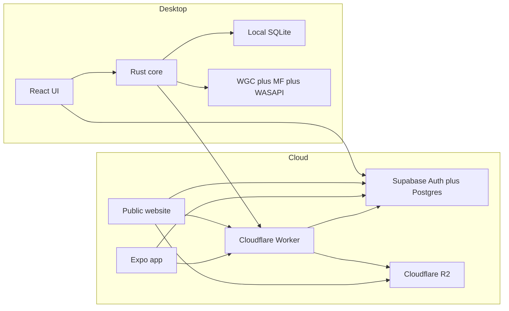
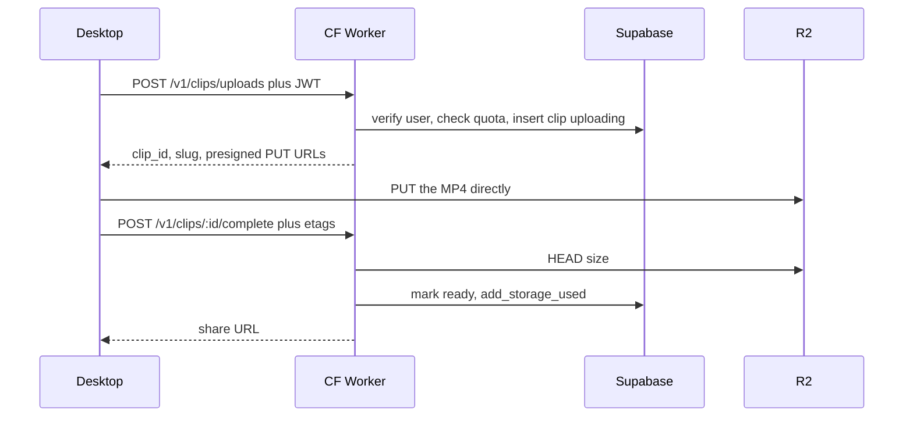

# Replayr

Gameplay clipper. Identifier `tv.elite.replay`. Site: [www.replayr.tv](https://www.replayr.tv).

It is a **native Tauri 2 app**, not a website in a wrapper.

- **Windows** is the clipper: Instant Replay, hotkeys, local library, then an optional cloud copy while signed in.
- **macOS** (Apple Silicon DMG) is the same signed-in shell: cloud library, folders, Following, messages, Explore. Recording and Instant Replay are Windows-only.
- The website (`web/`) and mobile app (`mobile/`) are the cloud library and share player. They do not record.

How systems work: [docs/ARCHITECTURE.md](docs/ARCHITECTURE.md).  
Audio routing: [docs/AUDIO_ROUTING.md](docs/AUDIO_ROUTING.md).  
Admin metric names: [docs/analytics-metrics.md](docs/analytics-metrics.md).  
This README is the operator and developer map.

## Contents

- [Hard rules](#hard-rules-read-these-first)
- [How to start](#how-to-start)
- [How everything works](#how-everything-works)
- [Publishing](#publishing)
- [Current status](#current-status)
- [Capture, Instant Replay, and Record](#capture-instant-replay-and-record)
- [Local and cloud library](#local-and-cloud-library)
- [Following and social](#following-and-social)
- [Accounts](#accounts)
- [Cloud upload](#cloud-upload)
- [Website and mobile](#website-and-mobile)
- [Admin](#admin)
- [Desktop internals developers hit](#desktop-internals-developers-hit)
- [Cloudflare](#cloudflare)
- [Database](#database)
- [Windows download and updates](#windows-download-and-updates)
- [macOS DMG](#macos-dmg)
- [Required software](#required-software)
- [Environment](#environment)
- [Setup](#setup)
- [Commands](#commands)
- [Local data](#local-data)
- [Directory layout](#directory-layout)
- [What is not done yet](#what-is-not-done-yet)
- [Security rules to keep](#security-rules-to-keep)

## Hard rules (read these first)

These are easy to break and expensive to undo.

- **Desktop is the clipper.** Do not merge `web/` into Tauri or rebuild capture on mobile.
- **Capture stays on Windows.** Do not change Windows capture, encode, remux, or `npm run tauri:build` (NSIS) to ship a Mac build. Mac packaging is `tauri:build:macos` and `.github/workflows/macos-dmg.yml` only.
- **Video path:** Desktop → R2. The Worker only mints URLs and verifies the object. Share links are `{origin}/c/{slug}` — never put a username in the URL.
- **Client env only:** `VITE_SUPABASE_URL`, `VITE_SUPABASE_ANON_KEY`, `VITE_PUBLIC_APP_URL` (and `EXPO_PUBLIC_*` on mobile). Vite embeds `VITE_*` at **build time**. Never put the service-role key or R2 keys in the desktop, website, or mobile app.
- **Admin** is `app_metadata.role === "admin"`, never `user_metadata`.
- **Unlisted clips** are watchable with the link. They must never appear in public listings, Explore, or For You.
- **No GPL FFmpeg sidecar.** Encode with Media Foundation.
- **Do not start audio Step 2** (separate MP4 tracks, isolated Discord / extra-app sources, Mode 2 exclusions) until mix-only clips are confirmed. Step 1 is **one mixed AAC track** (game process loopback when it works, optional desktop loopback, optional mic). Details: [docs/AUDIO_ROUTING.md](docs/AUDIO_ROUTING.md) and [docs/ARCHITECTURE.md](docs/ARCHITECTURE.md).

## How to start

Three processes. Desktop talks to the Worker at **8787**, not to the website Vite server.

1. Copy `.env.example` to `.env`. Put Worker / R2 / service-role secrets in `.env.cloudflare` (gitignored). See [Environment](#environment).
2. `npm install` at the repo root, then in `worker/`, `web/`, and `mobile/` as needed.
3. Three terminals:

```bash
npm run worker:dev
npm run web:dev
npm run tauri:dev
```

| Process | Port | What it is |
| --- | --- | --- |
| `worker:dev` | **8787** | API + share routes. Desktop `.env` must set `VITE_PUBLIC_APP_URL=http://127.0.0.1:8787` |
| `web:dev` | **5174** | Public website. Proxies `/v1` → 8787. Not the desktop API host |
| `tauri:dev` | Vite **1420** | Desktop WebView. Needs MSVC `vcvars64` on Windows |

Health check: [http://127.0.0.1:8787/v1/health](http://127.0.0.1:8787/v1/health) → `{"ok":true,"storage":true}`.

Windows `tauri:dev` via `cmd.exe` (PowerShell breaks `(x86)` paths):

```bat
"C:\Program Files (x86)\Microsoft Visual Studio\2022\BuildTools\VC\Auxiliary\Build\vcvars64.bat" && npm run tauri:dev
```

The app window **opens immediately**. Settings and auth load in the background (fail-open after a hung invoke). Do not run Instant Replay / WASAPI / Media Foundation on the Tauri UI thread.

Mobile (separate): `npm run mobile:start`. Website-only: worker + `web:dev` is enough.

## How everything works

Treat these as separate systems. The React UI never records, encodes, or retries uploads. It calls Tauri commands and renders state.

One request path in production: the desktop app, the website, and the phone all call `https://www.replayr.tv`. That hostname is the Cloudflare Worker. The Worker checks the Supabase JWT, reads and writes Postgres, and mints short-lived R2 URLs. Video bytes go from the desktop straight to R2. Postgres stores accounts, clip rows, social data, and quota. It never stores the MP4.

Locally the same split is three processes. The desktop talks to the Worker on port 8787. The website on port 5174 is only the Vite UI and proxies `/v1` to that Worker. Signing in always goes to Supabase Auth, even on localhost.



| Layer | Role |
| --- | --- |
| React + Vite (`src/`) | Shell, library, folders, Explore, Following, messages, account, settings. Supabase **anon** key only. |
| Rust / Tauri (`src-tauri/`) | Tray, hotkeys, filesystem, SQLite, capture, encode, remux, upload to R2, updater. Capture/encode are Windows-only. |
| SQLite | Local clips, settings, game catalog, upload queue. No auth tokens. |
| Supabase Auth | Email/password plus Google, Discord, and X. Session JWT is cloud identity. |
| Supabase Postgres | Profiles, games, clip metadata, folders, social, quota, analytics rollups. No video bytes. |
| Cloudflare Worker | JWT, presigned PUT/GET, quota, social APIs, `/c/{slug}` and `/f/{token}` players, coming-soon gate, static site + `latest.json`. |
| Website (`web/`) | Marketing, browser library, Explore, same-account sign-in, Windows + Mac downloads, desktop OAuth handoff. |
| Mobile (`mobile/`) | Expo cloud library, folders, and player. No capture. |
| Cloudflare R2 | MP4s. Keys: `clips/{user_id}/{clip_id}/original.mp4`. |

Production Worker origin is `https://www.replayr.tv`. Local desktop `.env` should point `VITE_PUBLIC_APP_URL` at `http://127.0.0.1:8787`.

## Current status

Windows is usable end to end: capture, local library, cloud upload, folders, following, messages, public/unlisted share links, likes/comments on **public** clips, in-app Windows updates.

| Area | Status |
| --- | --- |
| Desktop shell, tray, settings, SQLite, auth, onboarding | Done |
| Email + Google / Discord / X sign-in (desktop opens the browser) | Done |
| Game detection | Done (catalog from cloud + local SQLite) |
| WGC + Media Foundation + WASAPI → local MP4 | Done (Windows) |
| Instant Replay, Save Clip, session record, screenshot | Done (Windows) |
| Composed recording (layout burned into one MP4) | Done (Windows) |
| Local library (player, thumbs, favorite / rename / delete) | Done |
| Cloud upload to R2, quota, owner library | Done |
| Defer uploads until after the game (`cloudUploadWhen`) | Done |
| Folders (collab, public links, clip edits, activity) | Done |
| Following, follow requests, DMs, notifications | Done |
| Public `/c/{slug}` player, `/f/{token}` folder links | Done |
| Explore / For You (public clips only) | Done |
| Free / Premium billing (Stripe) | Done |
| In-app Windows updates (`latest.json` + signed `Replayr.exe`) | Done |
| macOS Apple Silicon DMG (cloud + social, no capture) | Done |
| Admin analytics (`/admin/analytics`) | Done |
| Mic mixed into the one AAC track (Step 1) | Done — do not start Step 2 yet |
| Isolated Discord/app tracks, Apple Sign-In, Intel Mac, notarization | Not started |
| DXGI exclusive-fullscreen fallback | Not started |

**Desktop nav:** Home, Library, Explore, Games, Record, **Following** (route `/friends`), Messages, Settings, Profile, Admin (admins only). Library has This PC / Cloud / Folders. The rail is fixed; only the page scrolls.

**Mac Record** is in the rail but capture commands return “Recording is only available on Windows.”

## Capture, Instant Replay, and Record

Windows only. Internals: [docs/ARCHITECTURE.md](docs/ARCHITECTURE.md#instant-replay).

```
Detected game window
  → Windows Graphics Capture
  → Media Foundation H.264 (hardware MFT when available)
  → WASAPI (game process loopback when it works + optional desktop + optional mic)
  → session MP4, or a short segmented replay buffer
```

**Game detection** runs in Rust. The catalog is data (`games.process_names`, wildcards allowed). The focused window wins if it is a catalog game; otherwise a running match is kept so alt-tabbing to Replayr does not clear detection. Instant Replay then **locks the PID** — alt-tab does not retarget capture.

**Instant Replay** is always-on rolling capture while enabled and a game is detected. It writes scratch segments into app cache (`replay-buffer`), not the Videos folder. Those files are wiped when IR stops, the game closes, or IR is turned off. **Save Clip** remuxes the last N seconds (bitstream copy) into a library MP4.

**Start Recording (legacy)** uses the same encoder. If IR is already rolling, recording **pins** the buffer (no restart). Stop concatenates the pinned window. Webcam is a sidecar `{file}-webcam.mp4`, not burned into gameplay.

**Composed recording** burns the Record layout (capture + webcam/image/text + overlay) into one MP4. IR must be off. Scenes live on the Record page (sources | preview | inspector; mixer + controls in the dock). Double-click a source in the source bar to rename it.

| Action | Default |
| --- | --- |
| Save Clip | Ctrl+F10 |
| Start/Stop recording | Ctrl+F9 |
| Screenshot | Ctrl+F11 |

Screenshots are local BMP stills and are not uploaded.

Exclusive fullscreen can miss Graphics Capture; borderless or windowed is reliable.

### Audio (Step 1)

Settings → Audio: Game Audio, system/desktop loopback on/off, one microphone (on/off, device, gain, meter). New installs leave the mic **off** until the user opts in. Live mic changes apply without rewriting the Instant Replay buffer.

The mic meter can open the device for level only. It does **not** mix into clips unless Microphone is on.

Do not run WASAPI open, Media Foundation, or `sync_replay` on the Tauri UI thread.

## Local and cloud library

Library is one page with three views. Local and cloud copies stay distinct.

- **This PC** — files in the save folder (default `{Videos}/Project Replay`), SQLite `local_clips`, in-app player, thumbs, favorite / rename / delete.
- **Cloud** — owner clips from the API. A fresh install has an empty This PC list even if Cloud has clips from another machine.
- **Folders** — shared collections (members, activity, optional public `/f/{token}` link, clip edits). Same folders on desktop, web, and mobile.

A local clip can point at a `cloud_clip_id`. Delete on desktop also deletes the cloud copy. “Remove from cloud” unlinks the upload and leaves the file on this PC.

Automatic upload defaults to **All clips** (Settings: Off or Favorites only). Settings can wait until you **exit the game** before uploading.

Cloud play asks the Worker for a signed URL (`GET /v1/clips/:slug` with the JWT), then the in-app `<video>` loads that URL. The Worker CORS list includes Windows (`https://tauri.localhost`) and Mac (`tauri://localhost`).

## Following and social

The desktop **Following** tab (route `/friends`) is the follow graph, not a separate friends product.

- Follow a **public** profile and it accepts immediately.
- Follow a **private** profile and it stays pending until they accept. Their clips/posts stay locked until then.
- Legacy `/v1/friends` still means **mutual accepted follows**. DMs require that mutual follow.
- Block is a separate table and clears follows.
- Explore / For You lists **public + ready** clips only. Unlisted is link-only (`/c/{slug}`) and must never appear in feeds.
- Likes and comments are public clips only.

Tables, endpoints, and the Worker vs RLS split: [docs/ARCHITECTURE.md](docs/ARCHITECTURE.md#following-and-social).

## Accounts

Supabase Auth is the only auth system.

- **Email + password** on desktop, web, and mobile.
- **Google, Discord, and X** on desktop, web, and mobile where those providers are enabled in Supabase.

Desktop social login does not stay in the webview. The app opens the system browser with `redirectTo` `https://www.replayr.tv/auth/desktop`. That page must stay reachable **without** the coming-soon cookie. It hands the PKCE `code` to `replayr://auth-callback`, and the app exchanges it for a session.

If a provider is allowed to fall back to the Site URL, `/?code=…` is treated as the same handoff and redirected to `/auth/desktop`.

After login, `supabase-js` persists the session through Tauri commands. The session JSON is **too large for Windows Credential Manager** (2560-byte cap), so it is a DPAPI-protected file under app data. Keyring is migration-only and must not fail sign-in. Passwords are never stored.

`handle_new_user` creates `profiles` and `user_storage` (free quota). Usernames are 3–24 characters, `[a-zA-Z0-9_]`, unique case-insensitively.

Onboarding is local SQLite (`onboardingCompleted`). A new portable install always looks like first run; if the signed-in profile already has a username, skip the username step.

For local testing, turn **Confirm email** off. Leave **Anonymous** disabled.

Auth database connections must use **percentage allocation** (about 10–20%), not a tiny fixed cap, or sign-up queues.

Add `https://www.replayr.tv/auth/desktop` and `https://www.replayr.tv/auth/callback` to the Supabase Auth redirect allowlist.

## Cloud upload

Bytes never go Desktop → Worker → R2. The Worker mints URLs and checks the result.



1. Signed-in Save Clip (or the cloud icon) asks `POST /v1/clips/uploads` with the JWT and file size.
2. The Worker checks quota, creates an **unlisted** `clips` row, and returns PUT URLs. The client cannot choose the R2 key.
3. Files over 8 MB use multipart. Upload goes straight to R2.
4. `POST /v1/clips/:id/complete` HEADs the object, rejects empty files, and calls `add_storage_used`.
5. **Copy link** is `{origin}/c/{slug}`.
6. A Worker cron aborts expired multipart leftovers.

Social (like / comment) is only for `visibility=public` and `status=ready`. Unlisted stays watchable, not listed.

## Website and mobile

The public marketing site is behind a **coming-soon gate** (`SITE_ACCESS_PASSWORD`) until the browser has the site-access cookie. These paths stay open without that cookie: `/v1/*`, `/releases/*`, `/c/*`, `/f/*`, `/auth/*`, and a homepage return that already has an OAuth `code`.

| URL | What it does |
| --- | --- |
| `https://www.replayr.tv/` | Product site (gated) and downloads |
| `/explore` | Public For You feed |
| `/library` | Signed-in cloud clips |
| `/library/folders` | Signed-in folders |
| `/friends`, `/messages` | Following and DMs |
| `/c/{slug}` | Clip share player |
| `/f/{token}` | Public folder |
| `/auth/desktop` | Desktop OAuth handoff → `replayr://` |
| `/auth/callback` | Website OAuth return |
| `/admin` | Operator console |
| `/admin/analytics` | Product analytics |
| `/releases/Replayr.exe` | Current Windows download (Workers Assets) |
| `/releases/Replayr.dmg` | macOS download (302 to the GitHub `macos` release) |
| `/releases/latest.json` | Windows updater manifest (must be JSON, never the SPA shell) |

```bash
npm run worker:dev
npm run web:dev
```

Local site: `http://127.0.0.1:5174`. Worker: `http://127.0.0.1:8787`. Vite proxies `/v1` to the Worker.

Mobile: `npm run mobile:start` (Expo). Same three public env values with the `EXPO_PUBLIC_` prefix.

## Admin

`/admin` on the website; desktop has a simpler Admin page. Both call `/v1/admin/*` with the JWT. The Worker accepts the request only when `app_metadata.role === "admin"`. Privileged writes use `SUPABASE_SERVICE_ROLE_KEY` on the Worker only.

`/admin/analytics` is the operator dashboard (growth, clips, folders, downloads, revenue, and the rest). Metric names are locked in [docs/analytics-metrics.md](docs/analytics-metrics.md).

```sql
update auth.users
set raw_app_meta_data = coalesce(raw_app_meta_data, '{}'::jsonb) || '{"role":"admin"}'::jsonb
where email = 'you@example.com';
```

Sign out and sign in again after granting admin. Unlisted clips can appear here for support. Deletes are soft (`status = deleted`) plus R2 removal.

## Desktop internals developers hit

### Tauri commands and ACL

Tauri 2 denies any app command that is not allowed. Custom permissions live in `src-tauri/permissions/`. `src-tauri/capabilities/default.json` must include `allow-app-commands` plus the audio / auth / shortcut allows. If you add a new `#[tauri::command]`, add it to `permissions/app.toml` (or the matching file) **and** `lib.rs` `generate_handler!`. Missing ACL looks like `list_local_clips not allowed` / command not found, empty Library, and “Game detection failed to start.”

### Do not block the UI thread

`set_setting` must not restart Instant Replay on the IPC thread. Only capture-related keys call `sync_replay`, and that runs on a background thread. Setup must not call `sync_replay` on the main thread either.

The window opens immediately. Settings and auth init in the background and fail-open after ~2.5s so a hung invoke cannot pin the UI forever.

### `tauri:dev` vs installed build

`npm run tauri:dev` needs the MSVC environment (`vcvars64.bat`). Native Rust changes need a full Tauri restart; Vite HMR is enough for React-only work.

In-app updates **do not run** in `tauri:dev`. Test updates from a downloaded `Replayr.exe` install.

PowerShell often breaks `vcvars` paths that contain `(x86)`. Use `cmd.exe`:

```bat
"C:\Program Files (x86)\Microsoft Visual Studio\2022\BuildTools\VC\Auxiliary\Build\vcvars64.bat" && npm run tauri:dev
```

## Publishing

Four ship paths. They do not share binaries. A website deploy does not ship a Windows update unless `web/public/releases/` already contains the signed installer and `latest.json`. A TestFlight build does not change the desktop updater.

| Ship | What users get | Where it runs |
| --- | --- | --- |
| Signed Windows update | `Replayr.exe` plus `latest.json` on the Worker | This Windows machine |
| Website | `https://www.replayr.tv` (SPA + API + downloads) | `npm run web:deploy` from this repo |
| TestFlight | iOS cloud app (`tv.elite.replay`) | EAS, then App Store Connect |
| macOS DMG | GitHub Release tag `macos` | [macOS DMG](#macos-dmg) workflow, not `tauri:build` |

### Signed Windows update

The updater endpoint is `https://www.replayr.tv/releases/latest.json` (`plugins.updater.endpoints` in `src-tauri/tauri.conf.json`). The manifest signature must match the exact bytes of `https://www.replayr.tv/releases/Replayr.exe`. Installed builds check Settings → Updates. `tauri:dev` does not.

1. Bump `version` in `package.json`, `src-tauri/tauri.conf.json`, `src-tauri/Cargo.toml`, and the `replay` package entry in `src-tauri/Cargo.lock`. Add notes for that version in `docs/release-notes.json`. `installer:stage` copies that file to `web/public/releases/release-notes.json`.
2. Build the NSIS bundle on Windows with a local `.env` (MSVC environment required). Production desktop builds should use `VITE_PUBLIC_APP_URL=https://www.replayr.tv` so the installed app talks to production, not port 8787.

```bat
"C:\Program Files (x86)\Microsoft Visual Studio\2022\BuildTools\VC\Auxiliary\Build\vcvars64.bat" && npm run tauri:build
```

3. Sign the new setup. The private key is `.tauri/updater.key` (no password). `--password=` is empty on purpose. Sign the setup file itself, not a copy you will later replace.

```powershell
npx @tauri-apps/cli signer sign --private-key-path .tauri/updater.key --password= -- path\to\Replayr_x.y.z_x64-setup.exe
```

4. Stage and deploy the Worker, which also publishes the website and the installer:

```bash
npm run installer:stage
npm run web:deploy
```

`installer:stage` copies the setup whose filename contains the current `tauri.conf.json` version to `web/public/releases/Replayr.exe` and writes `latest.json` from that file’s `.sig`. It searches `src-tauri/target` and the Cursor cargo sandbox cache. It fails if the signature is missing. Never invent a signature.

`web/public/releases/*.exe`, `*.dmg`, `*.sig`, and `latest.json` are gitignored. Deploy uploads whatever the website build copied into `web/dist/releases/`. Keep `Replayr.exe` in `web/public/releases/` on every website deploy, or the live Windows download disappears.

5. Check the live files before telling anyone to update:

- `https://www.replayr.tv/releases/latest.json` is JSON with the new `version` and a `windows-x86_64.signature`. It must not be the website HTML.
- `https://www.replayr.tv/releases/Replayr.exe` downloads.
- An older installed build shows the update in Settings, then **Restart to update**.

Signing-key rules are under [Windows download and updates](#windows-download-and-updates).

### Publish the website

The public site is not a separate host. `npm run web:deploy` builds `web/` and deploys the Cloudflare Worker `replay-api`. Wrangler serves `web/dist` as Workers Assets on `replayr.tv` and `www.replayr.tv`, and the Worker code is the API.

```bash
npm run web:deploy
```

That script builds the site, then runs `wrangler deploy` with `PUBLIC_APP_URL=https://www.replayr.tv` and `--keep-vars`, so other Worker vars and secrets stay. You need a Wrangler login that can deploy `replay-api` on the `replayr.tv` zone.

Before deploying:

- `web/public/releases/Replayr.exe` and `latest.json` are the Windows files you intend to keep live. The website build copies `web/public/` into `web/dist/`.
- Vite embeds `VITE_SUPABASE_URL` and `VITE_SUPABASE_ANON_KEY` from the repo `.env` at build time. Those are the client anon key, never the service-role key.
- Do not put R2 keys, Stripe keys, or `SUPABASE_SERVICE_ROLE_KEY` in any `VITE_` variable.

After deploying:

- `https://www.replayr.tv/v1/health` returns `{"ok":true,"storage":true}`.
- `/` is the gated marketing site. `/auth/desktop`, `/auth/callback`, `/v1/*`, `/releases/*`, `/c/*`, and `/f/*` stay open without the coming-soon cookie.
- `/releases/latest.json` is still JSON.

Worker source is `worker/`. Routes, the asset binding, rate limits, and the hourly cron live in `worker/wrangler.toml`. Production secrets are Worker secrets, not the gitignored `.env.cloudflare` file. Local `npm run worker:dev` copies `.env` and `.env.cloudflare` into `worker/.dev.vars` and forces `PUBLIC_APP_URL` to `http://127.0.0.1:8787`.

### TestFlight

iOS is the Expo app in `mobile/`. Capture stays on Windows. This repo is edited on Windows; the iOS binary is built by EAS, not a local Simulator.

Identifiers already in the repo:

| Item | Value |
| --- | --- |
| Bundle id | `tv.elite.replay` |
| EAS owner / slug | `elite6108` / `replayr` |
| EAS project | `90989ccf-3954-4736-b4e6-8602e8f7d1a0` |
| App Store Connect app | `6804367755` (`mobile/eas.json` → `submit.production.ios.ascAppId`) |
| Production profile | `environment: production`, `autoIncrement: true`, `EXPO_PUBLIC_APP_URL=https://www.replayr.tv` |

1. From `mobile/`, confirm `eas login` and that the EAS **production** environment has `EXPO_PUBLIC_SUPABASE_URL` and `EXPO_PUBLIC_SUPABASE_ANON_KEY` (same Supabase project as desktop). Never put the service-role key or R2 keys in EAS env.
2. Build:

```bash
cd mobile
npx eas-cli build --platform ios --profile production
```

The production profile uses an iOS `m-medium` builder and increments the build number from App Store Connect (`appVersionSource: remote`). `ITSAppUsesNonExemptEncryption` is already `false` in `mobile/app.json`.

3. Submit that build to TestFlight:

```bash
npx eas-cli submit --platform ios --profile production --latest
```

4. In App Store Connect, wait until the build finishes processing, then add internal testers. The first external TestFlight group needs Beta App Review.
5. Supabase Auth redirect allowlist must include `tv.elite.replay://auth/callback` and `https://www.replayr.tv/auth/callback`. Sign in with Apple has to be enabled in Supabase before shipping, because the app also offers Google, Discord, and X.

`runtimeVersion` is the app version (`appVersion` policy). `eas update` can ship JavaScript that matches a binary already installed from TestFlight. It cannot add native entitlements. Push (staff board → Expo → APNs) needs a new production build after the Push Notifications capability is on the App ID, plus Worker secret `EXPO_ACCESS_TOKEN`.

Local phone dev is separate: `npm run mobile:start`. Use `EXPO_PUBLIC_APP_URL=https://www.replayr.tv` on a device. `127.0.0.1` is the phone itself.

## Cloudflare

Production origin is the Worker **`replay-api`** (`worker/wrangler.toml`). `workers_dev` is false. Routes are `replayr.tv/*` and `www.replayr.tv/*`.

| Piece | Role |
| --- | --- |
| Worker code (`worker/src`) | `/v1/*` API, share routes, coming-soon gate, updater manifest guard, Mac DMG redirect |
| Workers Assets | `web/dist`, binding `ASSETS`, SPA fallback. `run_worker_first` so the gate runs before the SPA |
| R2 | MP4s. Keys `clips/{user_id}/{clip_id}/original.mp4`. The Worker mints presigned PUT/GET with the S3 credentials. The desktop uploads straight to R2 |
| Rate limits | Namespaces `1001`–`1020` in `wrangler.toml`. Missing binding fails closed |
| Cron | `15 * * * *` (abort expired multipart uploads and other scheduled work). Local dev does not fire it; `curl http://127.0.0.1:8787/cdn-cgi/local/scheduled` triggers one run |
| Secrets | `SUPABASE_SERVICE_ROLE_KEY`, R2 keys, Stripe, Bunny, Resend, `SITE_ACCESS_PASSWORD`, and the rest listed at the bottom of `wrangler.toml`. Set on the Worker. Never `VITE_` / `EXPO_PUBLIC_` |

Local Worker: `npm run worker:dev` → `http://127.0.0.1:8787`. Health: `{"ok":true,"storage":true}` means the Worker can see R2.

Deploy only through `npm run web:deploy` when you mean to publish the site and API together. `wrangler deploy` from `worker/` without a fresh `web/dist` can publish a stale or placeholder site. `--keep-vars` on the root deploy script keeps dashboard vars that are not in the command.

## Database

Supabase is Auth plus Postgres. There is one project for desktop, website, and mobile. The anon key is safe to embed. The service-role key lives only on the Worker.

Video never goes in Postgres. A clip row points at an R2 object. Apply every file in `supabase/migrations/` in filename order (SQL editor, or `supabase db push` after the CLI is linked to the project). There is no `supabase/config.toml` in this repo.

What Postgres holds: `plans`, `profiles`, `user_storage`, `games`, `clips`, `upload_sessions`, folders and members, follows, blocks, conversations, likes and comments, posts, billing, announcements, waitlist, staff boards, analytics events and daily aggregates. `handle_new_user` creates `profiles` and `user_storage`.

Visibility is `public`, `unlisted`, or `private`. Status is `uploading`, `processing`, `ready`, `failed`, or `deleted`. RLS lets clients list **public + ready** clips and their own rows. Unlisted playback is the Worker reading one row with the service role. Likes and comments are service-role writes. Admin is `app_metadata.role = admin` on `auth.users`, then sign out and back in.

Auth redirect allowlist: `https://www.replayr.tv/auth/desktop`, `https://www.replayr.tv/auth/callback`, and `tv.elite.replay://auth/callback`.

## Windows download and updates

Public download: **[Replayr.exe](https://www.replayr.tv/releases/Replayr.exe)** (NSIS current-user, no wizard). `src-tauri/windows/nsis-hooks.nsh` forces a silent extract, skips auto shortcuts, and launches the app. Desktop shortcuts are created from onboarding / Settings.

In-app updates read `https://www.replayr.tv/releases/latest.json`. Settings → Updates: check, then **Restart to update**. The nav Settings icon badges when an update is ready.

This path is **working**. `latest.json` is a signed Tauri updater manifest. If that URL ever returns the website HTML, the app shows `error decoding response body`. The Worker serves `/releases/latest.json` first and rejects non-JSON so the SPA fallback cannot impersonate the manifest.

### Signing keys

The **private** key is `.tauri/updater.key` (gitignored, no password). The matching **public** key is `plugins.updater.pubkey` in `src-tauri/tauri.conf.json`.

```bash
npx @tauri-apps/cli signer generate --ci -w .tauri/updater.key
```

Paste `.tauri/updater.key.pub` into `pubkey`. Never commit the private key. If it is lost, existing installs cannot verify new updates.

`TAURI_SIGNING_PRIVATE_KEY` is the **key contents**. `TAURI_SIGNING_PRIVATE_KEY_PATH` is the **file path**. `tauri build` often still fails to see the path env on this machine; sign the NSIS setup after the bundle exists.

The ship steps are [Signed Windows update](#signed-windows-update). Installed builds older than the live `latest.json` version should show the update in Settings. `tauri:dev` will not.

## macOS DMG

Mac builds run on GitHub Actions (`.github/workflows/macos-dmg.yml`), not on the Windows machine. `npm run tauri:build` stays NSIS-only.

- **Target:** `aarch64-apple-darwin` (Apple Silicon). Config: `src-tauri/tauri.macos.conf.json` (DMG only, ad-hoc sign `signingIdentity: "-"`, macOS 12+).
- **Command:** `npm run tauri:build:macos`
- **Publish:** GitHub Release tag `macos`, asset `Replayr.dmg`. `make_latest` is false so it does not replace the Windows updater release.
- **Website:** `GET /releases/Replayr.dmg` 302s to `https://github.com/elite6108/replayr/releases/download/macos/Replayr.dmg`. If that asset is missing, the Worker returns 404 JSON, not the SPA.

Vite needs production Supabase values at CI build time or the Mac app shows the local `.env` hint and cannot sign in. Those live on the GitHub **Replayr** environment (Actions secrets):

| Secret | Value |
| --- | --- |
| `VITE_SUPABASE_URL` | Same as local `.env` (`https://<project-id>.supabase.co`) |
| `VITE_SUPABASE_ANON_KEY` | Same as local `.env` (legacy anon JWT, not the service-role key) |

The workflow fails before the Tauri build if either secret is empty. `VITE_PUBLIC_APP_URL` is hardcoded to `https://www.replayr.tv` in the workflow.

Gatekeeper will still warn (ad-hoc signature). Notarization and Intel Mac are out of scope.

Do not put service-role or R2 secrets in the DMG.

## Required software

**Windows desktop (capture + NSIS):**

- Windows 10 or later
- [Node.js](https://nodejs.org/) 22+
- [Rust](https://rustup.rs/) stable (`x86_64-pc-windows-msvc`)
- [Visual Studio 2022 Build Tools](https://visualstudio.microsoft.com/visual-cpp-build-tools/) with **Desktop development with C++**
- WebView2 (usually already installed with Edge)

**macOS DMG:** GitHub-hosted `macos-latest` runner, Node 22, Rust `aarch64-apple-darwin`. Local Mac packaging is optional; CI is the ship path.

## Environment

Copy `.env.example` to `.env`.

**Desktop (safe to embed at build time):**

| Variable | Purpose |
| --- | --- |
| `VITE_SUPABASE_URL` | Supabase project URL (`https://<project-id>.supabase.co`) |
| `VITE_SUPABASE_ANON_KEY` | Anon / publishable key (legacy `eyJ…` JWT, same one Windows uses) |
| `VITE_PUBLIC_APP_URL` | Worker origin. Local: `http://127.0.0.1:8787`. Production desktop: `https://www.replayr.tv` |

**Mobile (`mobile/.env`):**

| Variable | Purpose |
| --- | --- |
| `EXPO_PUBLIC_SUPABASE_URL` | Same Supabase project URL |
| `EXPO_PUBLIC_SUPABASE_ANON_KEY` | Anon / publishable key |
| `EXPO_PUBLIC_APP_URL` | Production: `https://www.replayr.tv` |

**Worker / R2 (never `VITE_`):** `.env.cloudflare` (gitignored) → `npm run worker:dev` copies into `worker/.dev.vars`. There is no checked-in example file; required keys include `SUPABASE_URL`, `SUPABASE_ANON_KEY`, `SUPABASE_SERVICE_ROLE_KEY`, R2 account/bucket/keys, and `PUBLIC_APP_URL` (forced to `http://127.0.0.1:8787` locally).

**Mac CI:** same two `VITE_SUPABASE_*` values as Actions secrets on the `Replayr` environment. Not committed.

## Setup

1. Create a Supabase project. Enable Email auth plus the social providers you want. For desktop testing, turn off **Confirm email**. Leave Anonymous off.
2. Apply `supabase/migrations/` (SQL editor or `supabase db push`).
3. Put URL + anon key in `.env`. Set `VITE_PUBLIC_APP_URL=http://127.0.0.1:8787`.
4. Create an R2 bucket and API token. Put keys in `.env.cloudflare`.
5. `npm install` at the repo root, then `npm install` in `worker/`, `web/`, and `mobile/` as needed.
6. Start the three terminals in [How to start](#how-to-start).

## Commands

| Command | What it does |
| --- | --- |
| `npm run worker:dev` | Wrangler on 8787. Syncs `.env` + `.env.cloudflare` into `worker/.dev.vars`. |
| `npm run web:dev` | Website Vite on 5174. |
| `npm run tauri:dev` | Desktop (`tauri dev --no-watch`). Needs `vcvars64` on Windows. |
| `npm run tauri:dev:watch` | Same, with Tauri file watch. |
| `npm run dev` | Desktop Vite only (port 1420), no Tauri/Rust. |
| `npm run tauri:build` | Release NSIS installer (Windows only). |
| `npm run tauri:build:macos` | Apple Silicon DMG. Used by CI, not by `tauri:build`. |
| `npm run installer:stage` | `Replayr.exe` + `latest.json` from the matching `.sig`. |
| `npm run installer:stage:macos` | Copy the latest `*.dmg` to `web/public/releases/Replayr.dmg`. |
| `npm run web:deploy` | Build `web/` and deploy the Worker + assets (production `PUBLIC_APP_URL`). Keep `Replayr.exe` in `web/public/releases`. |
| `npm run typecheck` | Desktop TypeScript. |
| `npm run mobile:start` | Expo. |

```bash
cd src-tauri
cargo test
```

Worker health: `http://127.0.0.1:8787/v1/health` → `{"ok":true,"storage":true}`.

## Local data

Postgres is [Database](#database). Likes and comments have RLS enabled and no client policies (Worker service-role only). Triggers keep `clips.like_count` and `comment_count`.

**SQLite (desktop):** `settings`, `local_clips`, `upload_queue`, `games`. Migrations in `src-tauri/migrations/`. Auth tokens are not stored here. The session is a DPAPI-protected file under app data.

## Directory layout

```
src/                         React desktop UI
src-tauri/                   Rust / Tauri core
src-tauri/tauri.macos.conf.json  DMG-only Mac bundle (no NSIS)
src-tauri/migrations         SQLite
src-tauri/permissions        Tauri ACL (add new commands here)
supabase/migrations          Postgres / RLS
worker/                      API + share player + production static assets
web/                         Public website
web/public/releases          Staged Replayr.exe + latest.json (gitignored binaries)
mobile/                      Expo cloud app (no capture)
packages/social-types        Shared follow / folder types
.github/workflows/macos-dmg.yml  Apple Silicon DMG CI + GitHub Release
scripts/                     installer:stage (Windows + macOS)
.tauri/                      updater private key (gitignored)
docs/ARCHITECTURE.md         Current system design
docs/AUDIO_ROUTING.md        Audio plan (Step 1 shipped)
docs/analytics-metrics.md    Admin analytics dictionary
docs/release-notes.json      Updater notes keyed by version
```

## What is not done yet

- Isolated Discord / extra-app audio sources and **separate MP4 audio tracks** (Mode 1 Step 2)
- Mode 2 desktop mix with exclusions
- DXGI exclusive-fullscreen fallback
- Resume of interrupted multipart after a desktop restart
- Apple Sign-In on desktop
- Intel Mac DMG and Apple notarization
- Recording / Instant Replay on macOS

## Security rules to keep

- Desktop never ships service-role or R2 secrets
- Client cannot choose R2 paths
- Never trust client-reported size or MIME as final; Worker verifies with HEAD
- Unlisted clips must never appear in public PostgREST listings or Explore
- Clip URLs never include the username
- Auth tokens stay out of SQLite and `.env`
- Never commit `.tauri/updater.key` or invent an updater signature
- Mac CI secrets are client-safe Vite values only
